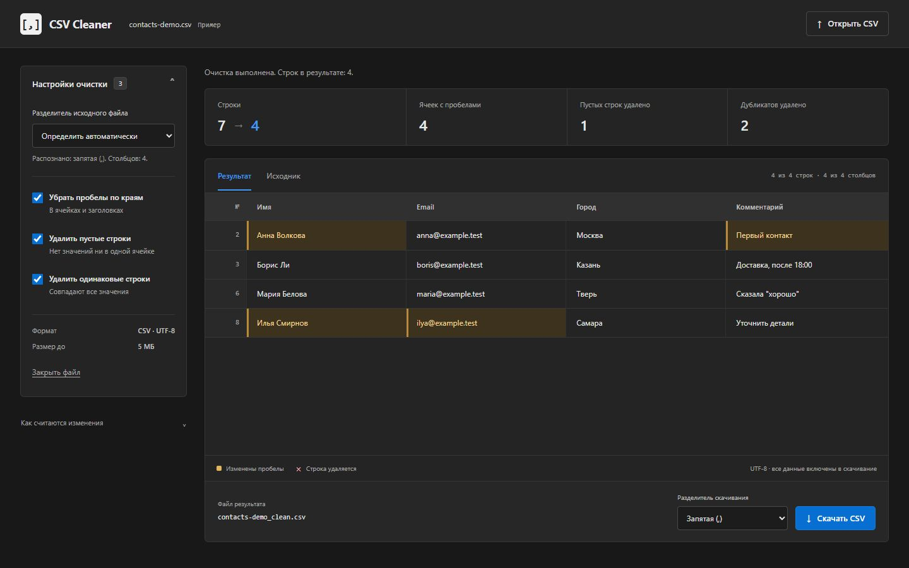
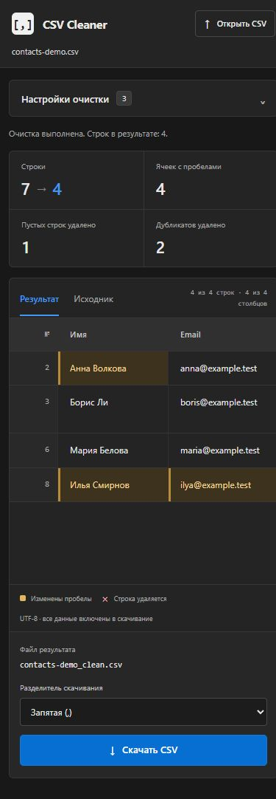

# CSV Cleaner

Небольшое веб-приложение для подготовки CSV-выгрузок к импорту в CRM или рабочую таблицу. Убирает пробелы, пустые строки и повторяющиеся записи, показывает результат и сохраняет новую копию файла.

**HTML · CSS · JavaScript · Node.js 24 · Без зависимостей · [MIT](LICENSE)**

> **Статус: в разработке, версия 0.1.** Основной сценарий очистки реализован и покрыт тестами. Интерфейс и работа с реальными выгрузками требуют дополнительной проверки и доработки. Проект публикуется как развивающийся инструмент; план — в [BACKLOG.md](docs/BACKLOG.md).

Содержимое CSV обрабатывается в памяти браузера; локальный сервер только отдаёт файлы приложения.



## Быстрый запуск

Нужен [Node.js](https://nodejs.org/) 24 или новее. Откройте терминал в папке проекта:

```sh
npm start
```

Перейдите на **http://127.0.0.1:4173**. Для остановки нажмите `Ctrl+C`. Команда `npm install` не нужна: зависимостей нет. Если порт занят, остановите предыдущий экземпляр приложения.

Двойной щелчок по `index.html` не подходит: браузеру нужен HTTP для JavaScript-модулей. Готовые HTML/CSS/JS также можно разместить на статическом хостинге; сборка не требуется.

## Попробовать за минуту

1. Нажмите **«Открыть пример»**. Все контакты в нём вымышленные, адреса используют домен `.test`.
2. Из 7 строк с данными останутся 4: будут убраны 1 пустая строка, 2 дубликата и пробелы в 4 ячейках.
3. Переключитесь на **«Исходник»**, затем вернитесь к результату.
4. Снимите любой переключатель, чтобы увидеть, как меняется результат.
5. Скачайте `contacts-demo_clean.csv`.

Для своего файла нажмите «Открыть CSV» или перетащите CSV в страницу. Разделитель исходника определяется автоматически. При неоднозначном файле выберите запятую или точку с запятой в настройках. Поле «Разделитель скачивания» независимо меняет формат результата: исходная таблица не разбирается заново и значения не теряются.

Интерфейс адаптирован по выбранному [Tabler / Datatables](https://preview.tabler.io/datatables.html): тёмная оболочка, компактная таблица и настройки сбоку. Bootstrap и другие библиотеки не подключаются; используются системные шрифты. Жёлтым отмечены ячейки с обрезанными пробелами, знаком × в исходнике — строки, которые удаляются. Номера записей включают строку заголовков.

## Возможности и правила

- UTF-8, включая BOM; разделители `,` и `;`; автоопределение с ручным выбором при неоднозначности. Кавычки и внутренние переносы учитываются при определении структуры.
- Первая строка содержит заголовки; она не удаляется как дубликат.
- Кавычки, удвоенные кавычки и переносы строк внутри кавычек поддерживаются. Неправильные кавычки и несовпадающая ширина непустых записей вызывают ошибку с номером CSV-записи.
- Сначала обрезаются пробелы по краям всех ячеек, включая заголовки. Затем удаляются пустые строки, затем полностью совпадающие записи. Каждое действие можно отключить.
- Пустая строка содержит только пустые или пробельные ячейки. Дубликаты сравниваются по всем значениям с учётом регистра; первая запись сохраняется, порядок строк не меняется.
- Счётчик исправленных ячеек включает обрезку пробелов до удаления строк. Число строк не включает заголовок.
- Типы данных не угадываются: `00123`, даты и формулы остаются строками. Содержимое отображается как текст, HTML из CSV не исполняется.
- Предпросмотр ограничен первыми **100 строками и 30 столбцами**, скачивание содержит весь результат.
- Результат записывается в CSV UTF-8 с BOM и переносами CRLF. Содержимое ячеек сохраняется, исходное оформление кавычек и внешние переводы строк могут нормализоваться.
- Формулы остаются в файле без изменений: при открытии в Excel или другом редакторе действуют правила этого редактора.

## Данные и ограничения

Лимит файла — **5 МиБ (5 242 880 байт)**, обозначенный в интерфейсе как 5 МБ. XLSX, Windows-1251, UTF-16, редактирование ячеек и синхронизация не поддерживаются. Если таблица в другой кодировке, сохраните её как CSV UTF-8 в своём табличном редакторе.

Исходный файл на диске не меняется. CSV и настройки не записываются в localStorage или на сервер; обновление страницы очищает рабочую таблицу. Ошибка до чтения нового файла сохраняет предыдущий результат. Ошибка разбора оставляет исходный текст новой выгрузки в памяти вкладки, чтобы можно было изменить разделитель.

## Проверки

```sh
npm test
```

Встроенный `node:test` проверяет парсинг сложных CSV, сохранность значений, порядок очистки, экспорт, ошибки UTF-8/размера, автоопределение, связь изменений с исходными строками, независимость импорта/экспорта и локальный HTTP-сервер. Дополнительных библиотек для тестов нет.

Фактическая браузерная проверка и её ограничения: [TESTING.md](docs/TESTING.md).

<details>
<summary>Мобильный интерфейс</summary>



</details>

## Устройство проекта

`src/csv.mjs` содержит чистую логику обработки данных, `app.js` связывает её с DOM. `scripts/serve.mjs` — локальный сервер с явным списком публичных файлов; входящих API и загрузки на сервер нет. Приложение использует относительные пути и системные шрифты.

Логика отделена от интерфейса:

```text
UTF-8 CSV → decodeUTF8 → parse / определение разделителя
                           ↓
                    CsvWorkspace — исходные данные и настройки
                           ↓
             trim → пустые строки → полные дубликаты
                           ↓
             предпросмотр с пометками / полный CSV-экспорт
```

`src/csv.mjs` отвечает за парсинг, очистку и сериализацию. `src/workspace.mjs` хранит состояние импорта и связь изменений с исходными строками. Импорт и формат скачивания разделены: смена выходного разделителя не переинтерпретирует исходные значения. В `tests/` — независимые проверки логики и HTTP; в `examples/` — синтетическая выгрузка.

## Развитие

Ближайший этап — улучшить читаемость таблицы и сценарий выбора разделителей, проверить файлы из реальных CRM на обезличенных примерах. Это отдельная работа после публикации. Полный список и критерии готовности — [BACKLOG.md](docs/BACKLOG.md).

## Лицензия и оформление

Исходники — [MIT](LICENSE). Визуальный ориентир — Tabler Datatables; Bootstrap, код Tabler и сторонние ассеты не включены. Собственные SVG и снимки приложения с вымышленными данными: [DESIGN.md](docs/DESIGN.md).
